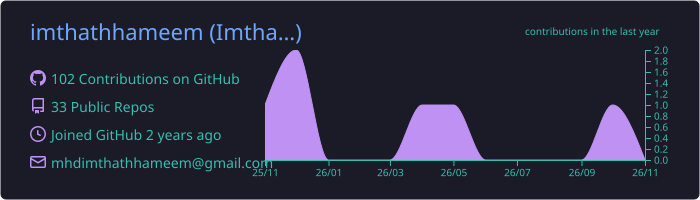
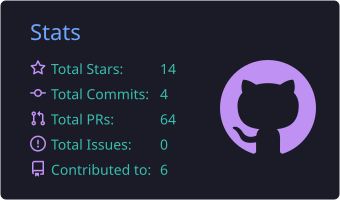
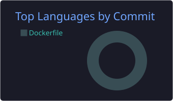
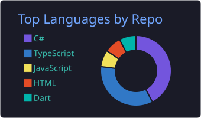
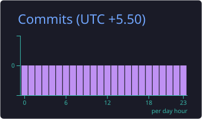

<!-- Header -->
<p align="center">
  
</p>

<p align="center">
  <a href="https://github.com/imthathhameem">
    
  </a>
</p>

<p align="center">
  <a href="https://www.linkedin.com/in/imthathhameem"></a>
  <a href="https://www.instagram.com/imthath.hameem"></a>
  <a href="mailto:mhdimthathhameem@gmail.com"></a>
  <a href="https://medium.com/@imthath_imt"></a>
  
</p>

---

## 👋 About Me

I'm a software developer from **Trincomalee, Sri Lanka 🇱🇰**, focused on designing and building **reliable, scalable and user-friendly web and mobile applications**. I enjoy turning real-world requirements into practical software — from planning and architecture through implementation, debugging and deployment.

```yaml
name: Hameem Mohamed Imthath
role: Team Lead @ Unicorn Connected Apps
also: Lecturer @ Unicom TIC
location: Sri Lanka
stack: [Angular, Flutter, C#, .NET, Entity Framework, SQL Server, MongoDB]
focus: [Clean Architecture, DDD, MVVM, Microservices, REST APIs]
learning: [Riverpod, .NET backend architecture, Azure & CI/CD, AI / RAG apps]
values: [clean code, maintainability, collaboration, continuous learning]
```

- 🔭 Currently a **Team Lead at Unicorn Connected Apps**, leading a team building web & mobile solutions
- 👨‍🏫 Teaching and mentoring students as a **Lecturer at Unicom TIC**
- 🌱 Deepening my knowledge of **Clean Architecture, DDD and MVVM**
- 🤖 Exploring **AI-powered applications, chatbots and RAG**
- 🎓 Studying for an **HND in Network Engineering**
- 💬 Ask me about **Angular, Flutter, .NET APIs and app architecture**

---

## 🛠️ Tech Stack

<p align="center">
  <br/>
  
</p>

| Area | Technologies |
| --- | --- |
| **Frontend** | Angular · TypeScript · HTML · CSS · Bootstrap |
| **Mobile** | Flutter · Dart · Riverpod · FVM |
| **Backend** | C# · ASP.NET Core / Web API · Entity Framework · REST · Microservices |
| **Databases** | Microsoft SQL Server · MongoDB · Data modelling |
| **Architecture** | Clean Architecture · DDD · MVVM · Repository & use-case design |
| **DevOps & Tools** | Git · GitHub · Azure DevOps · Visual Studio · VS Code |

---

## 💼 Experience

<details open>
<summary><b>Team Lead — Unicorn Connected Apps</b> · Jan 2025 – Present</summary>
<br/>

- Leading a team of developers and mentoring junior engineers
- Developing and enhancing web and mobile application features (Angular, Flutter, .NET)
- Working across frontend, backend and database layers (EF, SQL Server, MongoDB)
- Participating in planning, application design, implementation, deployment and code reviews
- Debugging, troubleshooting and writing clean, maintainable code

</details>

<details>
<summary><b>Lecturer — Unicom TIC</b> · Jun 2025 – Present</summary>
<br/>

- Helping students understand technical subjects and apply them in practical situations

</details>

<details>
<summary><b>Lab Instructor — Unicom TIC</b> · May 2025 – Jun 2025</summary>
<br/>

- Supported practical sessions, guided project work and helped learners troubleshoot
- Shared industry perspectives to connect learning with workplace expectations

</details>

<details>
<summary><b>Full-Stack Developer — Unicom TIC</b> · Apr 2024 – Dec 2024</summary>
<br/>

- Built and maintained web applications with Angular, Bootstrap, .NET and SQL Server

</details>

---

## 🚀 What I'm Building

| Project | Description |
| --- | --- |
| 🍽️ **OneNex** | Hospitality platform for restaurants — table reservations, QR menus & ordering, staff mobile app, check-in, service requests and optional Kitchen Display System integration. |
| 📍 **LocalGuide** | *Discover Locally. Experience More.* — a Trincomalee-first local discovery concept helping businesses reach more customers. *(early concept)* |
| 🎓 **Student-support chatbot** | Learning project exploring Retrieval-Augmented Generation (RAG) to answer student questions. |

---

## 📊 GitHub Stats

<!-- Cards are generated daily by .github/workflows/profile-cards.yml and stored in this repo -->
<p align="center">
  
</p>

<p align="center">
  
  
</p>

<p align="center">
  
  
</p>

<!-- Snake is generated daily by .github/workflows/snake.yml into the "output" branch -->
<p align="center">
  <picture>
    <source media="(prefers-color-scheme: dark)" srcset="https://raw.githubusercontent.com/imthathhameem/imthathhameem/output/github-snake-dark.svg" />
    
  </picture>
</p>

---

## 🎯 Goals

- 📈 Grow as a software engineer and take on greater technical responsibility
- 🎓 Progress from HND towards a degree in **Data Science**
- 🏗️ Build and grow my own technology business
- 🌍 Create products that serve markets beyond Sri Lanka

---

## 🤝 Let's Connect

I'm always happy to connect with developers, educators and people building useful digital products — whether it's collaborating on a project, exchanging ideas or contributing to open source.

<p align="center">
  
</p>
